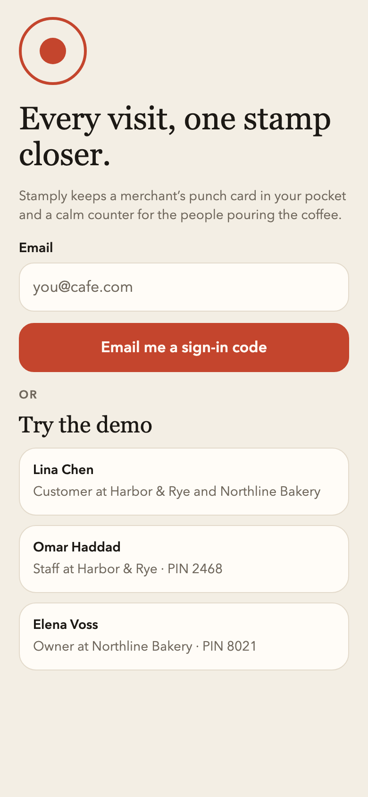
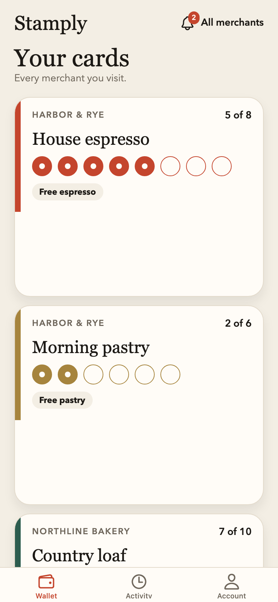
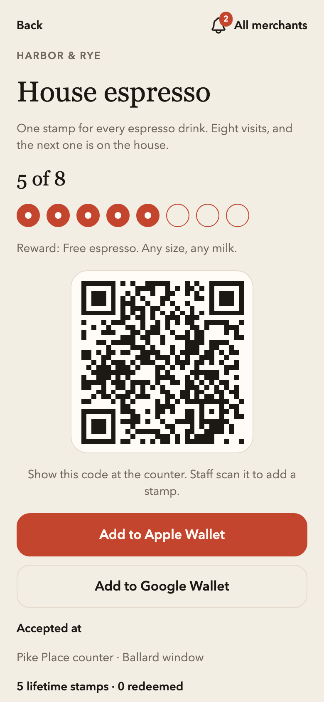
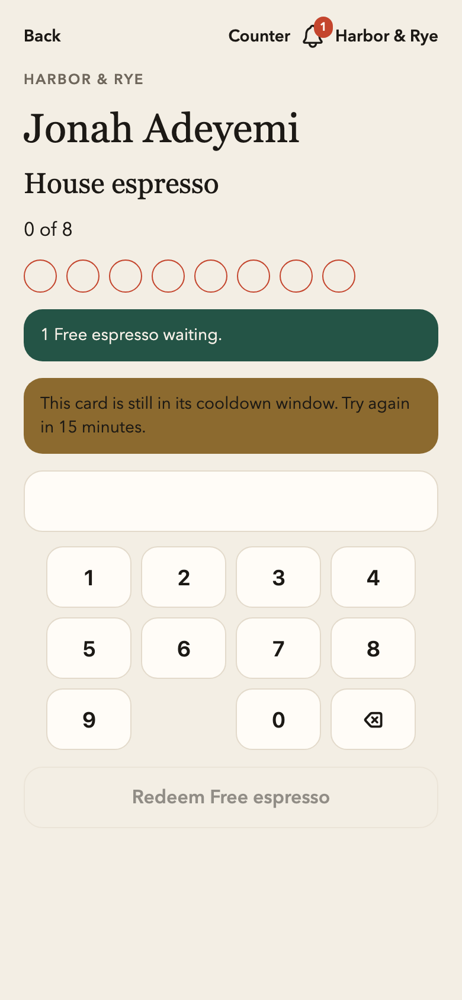
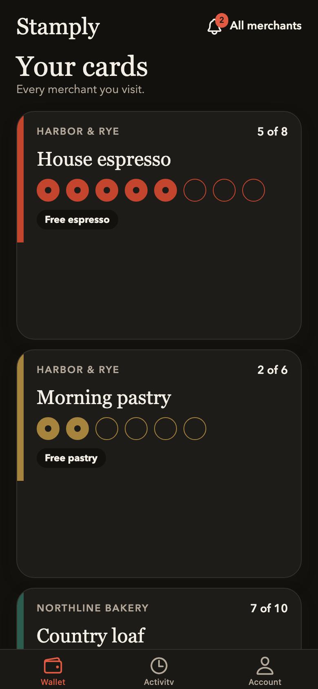

# Stamply

Stamply is the mobile companion for a multi-tenant QR loyalty stamp-card product. Customers carry one wallet of cards across merchants. Staff scan a customer’s code, confirm a PIN, and stamp or redeem under cooldown and daily limits.

The app runs with **no environment variables**. That path uses a seeded demo workspace stored on the device. When `EXPO_PUBLIC_SUPABASE_URL` and `EXPO_PUBLIC_SUPABASE_ANON_KEY` are both set, the same screens talk to the shared Supabase project. The anon key is the only key the app accepts. Row Level Security stays in charge.

Web preview target: [stamply-app.quvantic.com](https://stamply-app.quvantic.com)

Bundle identifiers: `com.quvantic.stamply`

## Features

- Magic-link sign-in. In the demo, the one-time code is shown on screen (`000000`). Against Supabase, the code arrives by email.
- Three demo seats: Lina Chen (customer), Omar Haddad (Harbor & Rye staff), Elena Voss (Northline owner).
- Wallet of stamp cards per merchant, with progress, paused cards, rewards, and a personal QR code.
- Org switcher and role-aware tabs. The Counter tab appears only for staff, admin, and owner seats.
- Staff scanner (`expo-camera` on iOS and Android). Web preview accepts a typed code and demo chips.
- Anti-fraud before a stamp lands: staff role, 4-digit PIN, program pause, cooldown, and a per-card daily cap. A waiting reward can still be redeemed during cooldown.
- Enroll a new customer from their join code.
- Apple Wallet and Google Wallet previews. Pass signing is mocked; the preview uses the live card data.
- In-app inbox, local push registration (`expo-notifications` on device, a stored token on web), and notification deep links.
- Light, dark, and system appearance.
- Offline cache of the last cards, activity, and counter summary.
- Deep links: `stamply://c/<token>` and `https://stamply-app.quvantic.com/c/<token>`.

## Screenshots

Captured from the Expo web export.

| Welcome | Wallet | Card |
| --- | --- | --- |
|  |  |  |

| Counter | Dark wallet |
| --- | --- |
|  |  |

A wider layout is in `docs/screenshots/wallet-desktop.png`.

## Architecture

```
src/app          Expo Router screens
src/domain       Pure rules: roles, QR parsing, cooldown, daily cap, reward reset
src/data         StamplyRepository
  mockRepository Seeded AsyncStorage workspace
  supabaseRepository  supabase-js, anon key, RLS, security-definer RPCs
supabase/migrations/20261125120000_stamply.sql
```

Shared tables: `organizations`, `profiles`, `members` (roles `owner`, `admin`, `staff`, `customer`), `programs`, `locations`, `cards`, `stamp_events`, `redemptions`, `notifications`, `wallet_passes`, `push_tokens`.

Staff PINs are checked inside `add_stamp`, `redeem_reward`, and `enroll_customer`. The `pin_hash` column is not granted to the client. The demo PINs (`2468` at Harbor & Rye, `8021` at Northline) are shown only while the app is in mock mode.

Billing plans (`trial`, `counter`, `house`) are visible on the account screen. Checkout stays on the web app.

## Mock and real mode

| | Mock | Supabase |
| --- | --- | --- |
| When | Either public env var is missing | Both URL and anon key are set |
| Sign-in | Any email, code `000000`, plus Try the demo | `signInWithOtp` and `verifyOtp` |
| Data | Seeded Harbor & Rye and Northline Bakery, persisted in AsyncStorage | Tenant rows the signed-in user can read under RLS |
| Push | Local token | Expo push token when `EXPO_PUBLIC_EAS_PROJECT_ID` is set, otherwise a local token |
| Wallet passes | Preview serial stored on device | Row in `wallet_passes` with status `mocked` |

Copy `.env.example` to `.env.local` only when you have a project. Do not put a service-role key in the app.

Apply `supabase/migrations/20261125120000_stamply.sql` on the same project the web app uses. New auth users get a profile from `handle_new_user`.

## Run

Requirements: Node 22, npm.

```bash
npm install
npm run web
```

Web serves on [http://127.0.0.1:43123](http://127.0.0.1:43123).

Expo Go (SDK 58):

```bash
npm start
```

Scan the QR with Expo Go. Camera scanning and local notifications need a device. The typed-code counter flow works in Expo Go as well.

Static web preview:

```bash
npm run export:web
npx serve dist -l 4173 -s
```

Host the `dist/` folder at `stamply-app.quvantic.com`. The export is a single-page app (`web.output: "single"`).

### EAS

`eas.json` has `development`, `preview`, and `production` profiles. This repo does not run cloud builds.

```bash
npx eas-cli@latest build --profile preview --platform android
```

You need an Expo account and, for store builds, Apple and Google developer memberships. No EAS project id is committed.

## Tests

```bash
npm run lint
npm run typecheck
npm test
npm run export:web
npm run test:e2e
```

- Jest and React Native Testing Library cover stamp rules, the mock repository (cooldown, daily cap, PIN, cross-merchant denial, magic link, enroll, persistence), and presentational components.
- Maestro flows live in `.maestro/` for the customer wallet, staff stamp and redeem, and magic link. They target `com.quvantic.stamply` on a simulator or device.
- Playwright smoke tests run against the web export so CI does not need a simulator.

GitHub Actions (`.github/workflows/ci.yml`) on `ubuntu-latest` runs lint, typecheck, unit tests, the web export, and Playwright with `@playwright/test` 1.65.1. No secrets.

## What still needs a person

- An Apple Developer account, Pass Type ID, and certificates before a real Apple Wallet pass can be signed.
- A Google Wallet issuer account and service account before a real Google pass can be saved.
- A Supabase project: run the migration, then set the URL and anon key. Invite staff and set `pin_hash` with `crypt` from pgcrypto.
- An Expo account and `EXPO_PUBLIC_EAS_PROJECT_ID` if you want Expo push tokens. FCM (Android) and APNs (iOS) credentials are required for delivery.
- DNS for `stamply-app.quvantic.com`, plus Apple associated domains and Android App Links verification for universal links.
- Store listings if you ship past the web preview. Do not run a paid EAS build until those accounts exist.
